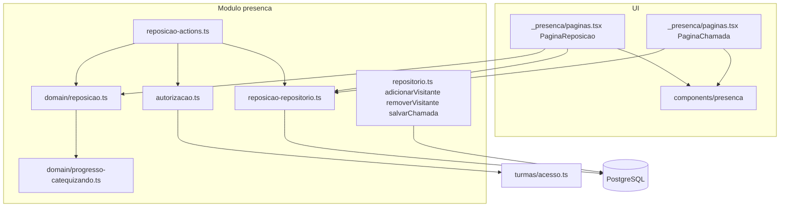
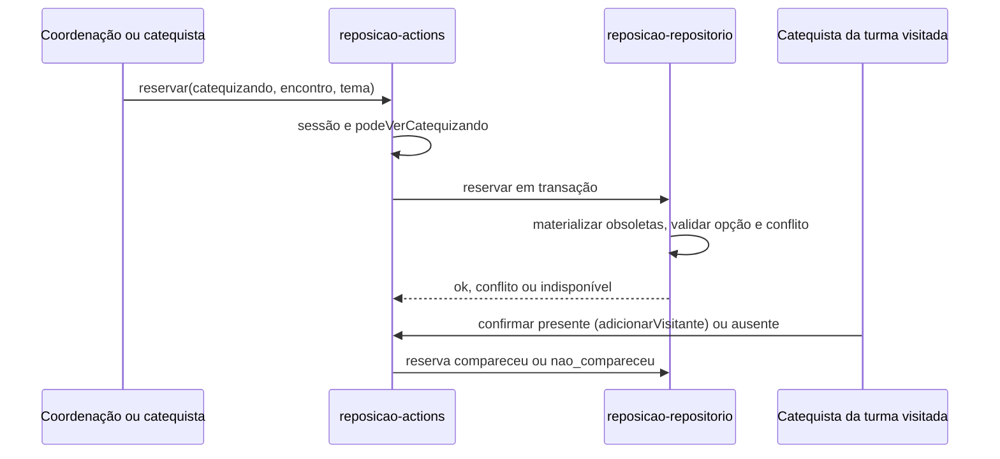
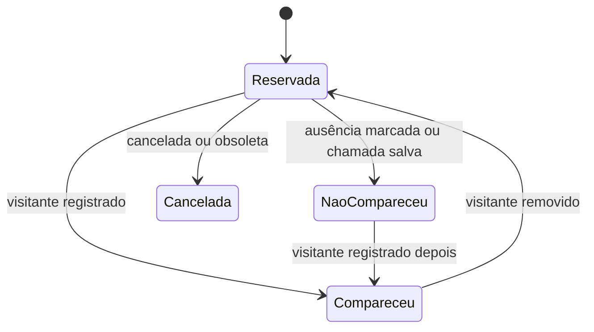

# Design Document

## Overview
**Purpose**: Esta feature entrega a visão "o que falta" de cada catequizando e a reserva do encontro de reposição.
**Users**: A coordenação consulta e reserva para qualquer catequizando; o catequista, para os das turmas em que é responsável, inclusive pelo celular; o catequista da turma visitada confirma o comparecimento na chamada.
**Impact**: Hoje o progresso mostra temas pendentes e o visitante só entra na chamada do dia. A spec acrescenta uma tabela de reservas, funções puras de cálculo no módulo `presenca`, uma página por catequizando e um bloco de reservas na chamada. Frequência e alerta não mudam.

### Goals
- Listar os temas a repor e as opções (turma, dia, data, horário) de cada um (2, 3).
- Reservar e cancelar a reposição com regras de conflito e disponibilidade (4).
- Mostrar a reserva na chamada da turma visitada e converter em visitante (5).
- Refletir mudanças de encontros e turmas sem editar outros módulos (6).

### Non-Goals
- Notificações, limite de vagas, acesso do catequizando, relatório consolidado por turma.
- Alterar frequência, alerta ou regras de chamada além do necessário para resolver reservas.

## Boundary Commitments

### This Spec Owns
- A **reserva de reposição**: dados, situações e transições.
- O cálculo de **tema a repor**, **opção de reposição**, **conflito de data** e **situação efetiva** da reserva.
- A visão "o que falta" e o bloco "Reposições reservadas" da chamada.
- Os contratos: `domain/reposicao.ts`, `reposicao-repositorio.ts`, `reposicao-actions.ts`.

### Out of Boundary
- Criar, editar, cancelar e reabrir encontros e temas (`programa-catequese`).
- Inscrever, desligar e encerrar turmas (`gestao-turmas`); estado do catequizando (`cadastro-catequizandos`).
- Presença do visitante, chamada, frequência e alerta: continuam de `controle-presenca`; esta spec só chama o registro de visitante existente.
- Notificação, vagas e conta de acesso do catequizando.

### Allowed Dependencies
- Os mesmos de `controle-presenca`: `@/modules/turmas/acesso`, arquivos puros `domain/*.ts` de `programa` e `turmas`, `@/modules/auth/dal`, `@/modules/compartilhado/{datas,busca}`, `@/lib/prisma`, `@/components/comum/*`.
- Arquivos do próprio módulo `presenca` (`repositorio.ts`, `autorizacao.ts`, `domain/progresso-catequizando.ts`).
- Proibido: importar `repositorio.ts` ou `actions.ts` de `programa`, `turmas` ou `catequizandos`; editar esses módulos.

### Revalidation Triggers
- Mudança em `Encontro.situacao`, `Encontro.temaId` ou na semântica de reabertura (a situação efetiva da reserva depende deles).
- Mudança em `Inscricao.dataSaida`, `Turma.encerradaEm` ou `Catequizando.estado`.
- Mudança nas assinaturas de `adicionarVisitante`, `removerVisitante` e `salvarChamada` do módulo `presenca`.
- Mudança em `calcularProgressoCatequizando` (os temas a repor derivam de `pendentes`).

## Architecture

### Existing Architecture Analysis
- Módulo `presenca` com `domain/` puro, `repositorio.ts` (`server-only`), `actions.ts`, `autorizacao.ts` e `mensagens.ts`; páginas compartilhadas por papel em `_presenca/paginas.tsx`.
- Acesso por `podeVerTurma` e `podeVerCatequizando`, reavaliado a cada chamada; avisos por `?aviso=` e `useActionState`.
- Visitante é uma `Presenca` com `visitante = true`, única por `(encontroId, catequizandoId)`.
- Índices únicos parciais já são criados em SQL manual nas migrações (por exemplo `link_ativo_unico`).

### Architecture Pattern & Boundary Map


**Architecture Integration**:
- **Padrão escolhido**: extensão do módulo `presenca` com arquivos `reposicao-*`, na mesma forma `domain` ← `repositorio` ← `actions` ← `app/components`.
- **Direção de dependência**: `domain/reposicao.ts` → `domain/progresso-catequizando.ts`; `reposicao-repositorio.ts` → `domain`; `reposicao-actions.ts` → repositório e autorização; UI → ações e repositório. Nada importa para a direita.
- **Padrões preservados**: acesso por turma a cada chamada, `?aviso=`, `useActionState`, textos em `mensagens.ts`, migração com SQL manual.
- **Componentes novos**: justificados na seção Components and Interfaces.
- **Conformidade com o steering**: TypeScript strict sem `any`, Zod nos limites, Conventional Commits, regra de negócio com teste.

### Technology Stack

| Layer | Choice / Version | Role in Feature | Notes |
|-------|------------------|-----------------|-------|
| Frontend | Next.js 16 (App Router, RSC) | Página "o que falta" e bloco de reservas na chamada | Sem componente cliente novo além de botões com estado de ação |
| Backend | Server Actions, Zod | Reservar, cancelar, marcar não compareceu | Sem rotas de API |
| Data | PostgreSQL + Prisma 7 | Tabela `reserva_reposicao` | Índice único parcial em SQL manual |
| Testes | Vitest, Playwright | Unitários do domínio, integração das ações, e2e do fluxo | Viewport móvel no e2e |

## File Structure Plan

### Directory Structure
```
src/modules/presenca/
├── domain/
│   └── reposicao.ts              # tipos; temasARepor, opcoesDoTema, conflitoDeData, situacaoEfetiva, motivoDeCancelamento
├── reposicao-repositorio.ts      # server-only: candidatos, reservas, materializar obsoletas, reservar, cancelar, nao-compareceu
├── reposicao-actions.ts          # "use server": reservarReposicaoAction, cancelarReservaAction, naoCompareceuAction
src/components/presenca/
├── o-que-falta.tsx               # temas a repor, opções e reserva em destaque
├── historico-reservas.tsx        # reservas com situação, turma, data e motivo
└── reservas-da-chamada.tsx       # bloco de reservas na chamada com confirmar e ausência
src/app/(interno)/coordenacao/catequizandos/[id]/reposicao/page.tsx
src/app/(interno)/catequista/catequizandos/[id]/reposicao/page.tsx
prisma/migrations/<data>_reposicao/migration.sql
tests/unit/presenca/reposicao.test.ts
tests/integration/presenca/{reposicao-repositorio,reposicao-actions,visitante-reserva}.test.ts
tests/e2e/reposicao.spec.ts
```

### Modified Files
- `prisma/schema.prisma`: enum `SituacaoReserva`, modelo `ReservaReposicao` e relações em `Catequizando`, `Tema`, `Encontro` e `Turma`.
- `src/modules/presenca/repositorio.ts`: `adicionarVisitante` marca a reserva como `compareceu`; `removerVisitante` devolve para `reservada`; `salvarChamada` marca `reservada` como `nao_compareceu`, tudo na mesma transação.
- `src/modules/presenca/mensagens.ts`: códigos e textos de reserva.
- `src/app/(interno)/_presenca/paginas.tsx`: `PaginaReposicao` e o bloco `ReservasDaChamada` em `PaginaChamada`.
- `src/components/presenca/frequencia-catequizando.tsx` e `src/components/presenca/frequencia-turma.tsx`: link "O que falta".
- `src/app/globals.css`: estilos do bloco e das opções.
- `tests/integration/setup.ts` e `tests/e2e/preparar-banco.ts`: incluir `reserva_reposicao` no `TRUNCATE`.

## System Flows

### Reservar e confirmar


### Situações da reserva


A situação **efetiva** é calculada na leitura: uma reserva `reservada` vira `cancelada` (com motivo) quando o encontro foi cancelado, o tema do encontro mudou ou foi retirado, a inscrição de origem terminou, o catequizando foi inativado ou a turma visitada foi encerrada. Nas escritas do mesmo catequizando, as obsoletas são gravadas como `cancelada` com o motivo.

## Requirements Traceability

| Requirement | Summary | Components | Interfaces | Flows |
|-------------|---------|------------|------------|-------|
| 1.1, 1.2 | Acesso por papel | Autorizacao, reposicao-actions, PaginaReposicao | `autorizarCatequizando` | Reservar |
| 1.3 | Negar sem revelar dados | Autorizacao | redireciona a `/acesso-negado` antes de ler | — |
| 1.4 | Exigir autenticação | Autorizacao | `requireSession` | — |
| 2.1 | Lista dos temas a repor | domain/reposicao, OQueFalta | `temasARepor` | — |
| 2.2, 2.3, 2.4 | Definição de tema a repor | domain/reposicao, reposicao-repositorio | `temasARepor`, `temasTrabalhados` | — |
| 2.5, 2.6 | Estados vazios | OQueFalta | — | — |
| 3.1, 3.2, 3.3 | Opções de reposição | domain/reposicao, reposicao-repositorio | `opcoesDoTema`, `candidatosDeReposicao` | — |
| 3.4 | Excluir presença ou reserva ativa | domain/reposicao | `opcoesDoTema` | — |
| 3.5, 3.6 | Sem opção; reserva em destaque | OQueFalta | — | — |
| 4.1, 4.2 | Reservar; uma ativa por tema | reposicao-actions, reposicao-repositorio, índice único | `reservar` | Reservar |
| 4.3 | Conflito de data | domain/reposicao | `conflitoDeData` | Reservar |
| 4.4 | Opção indisponível | reposicao-repositorio | `reservar` revalida | Reservar |
| 4.5 | Cancelar | reposicao-actions, reposicao-repositorio | `cancelar` | — |
| 4.6 | Sem efeito em inscrição e frequência | reposicao-repositorio | só escreve em `reserva_reposicao` | — |
| 5.1 | Reservas na chamada | ReservasDaChamada, reposicao-repositorio | `reservasDoEncontro` | — |
| 5.2 | Confirmar comparecimento | repositorio.adicionarVisitante | `adicionarVisitante` | Confirmar |
| 5.3 | Marcar ausência | reposicao-actions, reposicao-repositorio | `marcarNaoCompareceu` | Confirmar |
| 5.4 | Chamada salva resolve | repositorio.salvarChamada | transação existente | — |
| 5.5 | Sem efeito na frequência | — | nenhuma presença é criada para reserva ou ausência | — |
| 5.6 | Visitante direto continua | repositorio.adicionarVisitante | inalterado para quem não tem reserva | — |
| 6.1, 6.2, 6.3 | Mudanças cancelam a reserva | domain/reposicao, reposicao-repositorio | `situacaoEfetiva` (a materialização é interna a `reservar`) | Situações |
| 6.4 | Histórico | HistoricoReservas | `reservasDoCatequizando` | — |
| 7.1 | Uso no celular | OQueFalta, ReservasDaChamada, globals.css | — | — |
| 7.2 | Confirmar e atualizar | reposicao-actions | `useActionState`, `revalidatePath` | — |

## Components and Interfaces

| Component | Domain/Layer | Intent | Req Coverage | Key Dependencies (P0/P1) | Contracts |
|-----------|--------------|--------|--------------|--------------------------|-----------|
| domain/reposicao | Domain | Regras puras de tema a repor, opções, conflito e situação efetiva | 2, 3, 4.3, 6 | progresso-catequizando (P0), datas (P0) | Service |
| reposicao-repositorio | Persistência | Consultas e escritas de reserva | 2.2, 3, 4, 5, 6 | Prisma (P0), domain/reposicao (P0) | Service, State |
| reposicao-actions | Server Actions | Reservar, cancelar, marcar não compareceu | 1, 4, 5.3, 7.2 | autorizacao (P0), reposicao-repositorio (P0) | Service |
| OQueFalta / HistoricoReservas / ReservasDaChamada | UI | Apresentação | 2, 3, 5.1, 6.4, 7 | actions (P0) | — |

### Domain

#### domain/reposicao

| Field | Detail |
|-------|--------|
| Intent | Decidir, sem I/O, o que falta, onde repor e se uma reserva ainda vale |
| Requirements | 2.1–2.4, 3.1–3.4, 4.3, 6.1–6.3 |

**Responsibilities & Constraints**
- Funções puras e determinísticas; a data atual entra por parâmetro.
- Não importa framework, `server-only` nem persistência.

##### Service Interface
```typescript
import type { DataCivil } from "@/modules/compartilhado/datas";
import type { TemaDoProgresso } from "@/modules/programa/domain/progresso";

export type SituacaoReserva = "reservada" | "compareceu" | "nao_compareceu" | "cancelada";
export type MotivoObsolescencia =
  | "encontro-cancelado" | "tema-alterado" | "saiu-da-turma"
  | "catequizando-inativo" | "turma-encerrada";

export interface TemaARepor { id: string; numero: number; titulo: string }

export interface EncontroCandidato {
  encontroId: string; turmaId: string; turmaNome: string;
  diaSemana: string; data: DataCivil; horario: string; temaId: string;
}

export interface OpcaoDeReposicao extends EncontroCandidato { conflito: boolean }

export interface ReservaAtiva { encontroId: string; temaId: string; data: DataCivil }

/** Pendentes que já foram trabalhados na turma de origem, na ordem do programa. */
export function temasARepor(
  pendentes: readonly TemaDoProgresso[],
  trabalhadosNaOrigem: ReadonlySet<string>,
): TemaARepor[];

/** Candidatos do tema, sem os encontros em que já há presença ou reserva ativa, por data. */
export function opcoesDoTema(
  temaId: string,
  candidatos: readonly EncontroCandidato[],
  jaConstam: ReadonlySet<string>,
  datasOcupadas: ReadonlySet<DataCivil>,
): OpcaoDeReposicao[];

export function conflitoDeData(
  data: DataCivil,
  datasDaOrigem: ReadonlySet<DataCivil>,
  reservas: readonly ReservaAtiva[],
): boolean;

export interface ContextoDaReserva {
  situacao: SituacaoReserva;
  encontroSituacao: "planejado" | "realizado" | "cancelado";
  temaDoEncontro: string | null;
  temaDaReserva: string;
  origemVigente: boolean;
  catequizandoAtivo: boolean;
  turmaVisitadaEncerrada: boolean;
}

export type SituacaoEfetiva =
  | { situacao: Exclude<SituacaoReserva, "cancelada"> }
  | { situacao: "cancelada"; motivo: MotivoObsolescencia | "cancelada-por-usuario" };

export function situacaoEfetiva(contexto: ContextoDaReserva): SituacaoEfetiva;
```
- Preconditions: datas em `AAAA-MM-DD`; `pendentes` já filtrada a temas ativos.
- Postconditions: `temasARepor` mantém a ordem do programa; `opcoesDoTema` ordena por data e depois por nome da turma.
- Invariants: só `reservada` pode virar `cancelada` por obsolescência; `compareceu` e `nao_compareceu` nunca são derivadas.

### Persistência

#### reposicao-repositorio

| Field | Detail |
|-------|--------|
| Intent | Ler candidatos e reservas e escrever reservas com consistência |
| Requirements | 2.2, 3.1–3.4, 4.1–4.6, 5.1, 5.3, 6.1–6.4 |

**Dependencies**
- Inbound: reposicao-actions, páginas — leitura e escrita (P0)
- Outbound: Prisma (P0), `cumpridosDoCatequizando` e `temasAtivosNumerados` de `repositorio.ts` (P0)

**Contracts**: Service [x] / State [x]

##### Service Interface
```typescript
export type ResultadoReserva =
  | { ok: true; reservaId: string }
  | { ok: false; motivo: "indisponivel" | "conflito-de-data" | "ja-reservada" | "sem-origem" };

export interface VisaoDoCatequizando {
  origemTurmaIds: string[];
  temas: { tema: TemaARepor; opcoes: OpcaoDeReposicao[]; reserva: ReservaDetalhada | null }[];
}

/** Temas de encontros realizados nas turmas de origem (base de `temasARepor`). */
export function temasTrabalhados(origemTurmaIds: readonly string[]): Promise<Set<string>>;
/** Encontros planejados, futuros, de turmas abertas fora da origem, com algum dos temas. */
export function candidatosDeReposicao(
  temaIds: readonly string[], origemTurmaIds: readonly string[], hoje: DataCivil,
): Promise<EncontroCandidato[]>;
export function visaoOQueFalta(catequizandoId: string, hoje: DataCivil): Promise<VisaoDoCatequizando>;
export function reservasDoCatequizando(catequizandoId: string): Promise<ReservaDetalhada[]>;
export function reservasDoEncontro(encontroId: string): Promise<ReservaDaChamada[]>;
export function reservar(
  entrada: { catequizandoId: string; encontroId: string; temaId: string; criadoPorId: string },
  hoje: DataCivil,
): Promise<ResultadoReserva>;
export function cancelar(reservaId: string, catequizandoId: string): Promise<"ok" | "indisponivel">;
export function marcarNaoCompareceu(encontroId: string, catequizandoId: string): Promise<"ok" | "indisponivel">;
```
- Preconditions: ids válidos (UUID); acesso já autorizado pela action.
- Postconditions: `reservar` grava `reservada` ou nada; `cancelar` só altera `reservada`; nenhuma função escreve em `presenca`, `inscricao` ou `encontro`.
- Invariants: no máximo uma reserva `reservada` por `(catequizandoId, temaId)` (índice único parcial).

##### State Management
- **Consistência**: `reservar` roda em transação: (1) revalida o encontro (planejado, tema igual, data >= hoje, turma aberta, fora da origem), (2) grava como `cancelada` as reservas obsoletas do catequizando, (3) recusa conflito de data, (4) insere. `P2002` do índice único vira `ja-reservada`.
- **Concorrência**: última escrita vence apenas em `cancelar` e `marcarNaoCompareceu`, que são idempotentes.

### Server Actions

#### reposicao-actions

| Field | Detail |
|-------|--------|
| Intent | Autorizar, validar a entrada e chamar o repositório |
| Requirements | 1.1–1.4, 4.1–4.5, 5.3, 7.2 |

##### Service Interface
```typescript
export function reservarReposicaoAction(
  catequizandoId: string, base: string, estado: EstadoPresenca, dados: FormData,
): Promise<EstadoPresenca>;
export function cancelarReservaAction(
  catequizandoId: string, reservaId: string, base: string,
): Promise<void>;
export function naoCompareceuAction(
  turmaId: string, encontroId: string, catequizandoId: string, base: string,
): Promise<void>;
```
- `reservar` e `cancelar` exigem `podeVerCatequizando`; `naoCompareceu` exige `podeVerTurma` da turma visitada e chamada disponível.
- Confirmar presente reaproveita `adicionarVisitanteAction` existente.

## Data Models

### Logical Data Model
- `ReservaReposicao` pertence a um `Catequizando`, a um `Tema` e a um `Encontro` de destino; guarda a turma de origem no momento da reserva.
- Regras: um catequizando tem no máximo uma reserva `reservada` por tema; a reserva só nasce para encontro `planejado` do tema, em turma aberta e diferente da origem.

### Physical Data Model
```
reserva_reposicao
  id                  uuid  PK default uuid
  catequizandoId      uuid  FK catequizando (Restrict)
  temaId              uuid  FK tema (Restrict)
  encontroId          uuid  FK encontro (Restrict)
  turmaOrigemId       uuid  FK turma (Restrict)
  criadoPorId         text  (id do usuário; sem FK, como link_autocadastro.criadoPorId)
  situacao            situacao_reserva  default 'reservada'
  motivoCancelamento  text  null
  createdAt, updatedAt
INDEX (catequizandoId), INDEX (encontroId)
UNIQUE PARCIAL reserva_ativa_unica (catequizandoId, temaId) WHERE situacao = 'reservada'
```
O índice parcial entra em SQL manual na migração, como `link_ativo_unico`.

## Error Handling

### Error Strategy
Erros de regra voltam como mensagem no formulário; falhas inesperadas mostram a mensagem genérica já existente.

### Error Categories and Responses
- **Usuário**: sem acesso → `/acesso-negado` sem ler dados; id inválido → não encontrado.
- **Regra**: opção indisponível (4.4), conflito de data (4.3), já reservada (4.2), sem turma de origem (2.6) → mensagem explicando a condição.
- **Sistema**: exceção do banco → mensagem genérica e nenhuma reserva parcial (transação).

## Testing Strategy

### Unit Tests
- `temasARepor`: exclui cumpridos e temas não trabalhados; mantém a ordem do programa (2.2–2.4).
- `opcoesDoTema`: ordena por data, exclui encontros com presença ou reserva ativa, marca conflito (3.1, 3.4, 4.3).
- `situacaoEfetiva`: cada motivo de obsolescência; `compareceu` e `nao_compareceu` intocadas (6.1–6.3).
- `conflitoDeData`: data da origem e reserva na mesma data (4.3).

### Integration Tests
- `reservar`: sucesso, indisponível, conflito, duas reservas do mesmo tema em corrida (4.1–4.4).
- Materialização: reserva obsoleta não bloqueia nova reserva do mesmo tema (6.1–6.3).
- `adicionarVisitante` com reserva marca `compareceu`; sem reserva continua igual (5.2, 5.6).
- `salvarChamada` marca pendentes como `nao_compareceu` e não cria presença (5.4, 5.5).
- Acesso: catequista fora da turma é negado sem dados (1.2, 1.3).

### E2E/UI Tests
- Coordenação abre "o que falta", reserva em outra turma e vê a reserva em destaque (3.6, 4.1).
- Catequista da turma visitada vê a reserva na chamada, confirma presente e o tema deixa de ser listado (5.1, 5.2).
- Cancelar a reserva volta a mostrar as opções (4.5); viewport móvel sem rolagem horizontal (7.1).

## Security Considerations
- A leitura entre turmas é limitada a nome da turma, dia, data, horário e tema das opções, e a nome e turma de origem do catequizando com reserva; nada mais da ficha.
- Toda action reavalia sessão e acesso e valida UUIDs antes de consultar.

## Performance & Scalability
- A visão faz uma consulta de candidatos para todos os temas a repor; o volume é de dezenas de encontros por catequizando.
